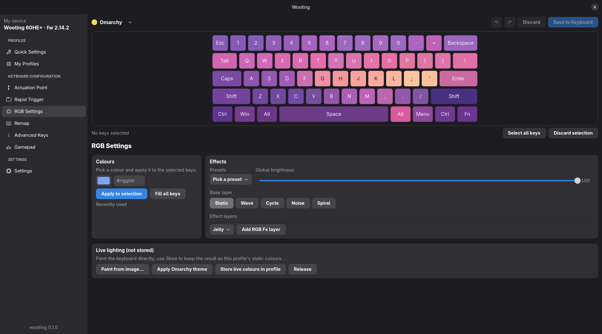
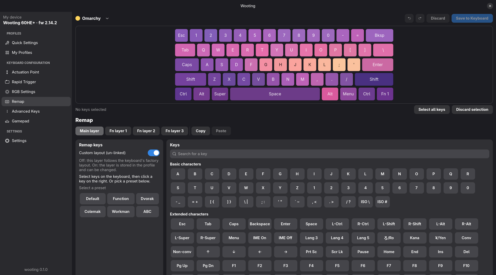
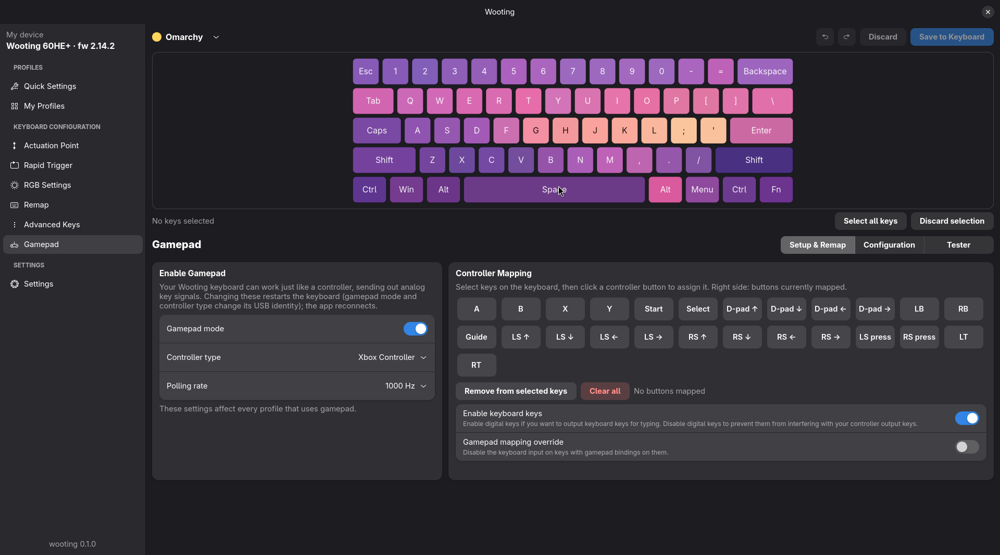

# wooting

Native Linux control for Wooting analog keyboards: a daemon, a CLI, a
GTK4/libadwaita app and an agent-friendly API, written in Rust. Covers
everything Wootility does for day-to-day use, works on Wayland without a
browser, and lets scripts or AI agents drive the keyboard.

Built and verified on a **Wooting 60HE+** (firmware 2.14.2) running
[Omarchy](https://omarchy.org) (Hyprland). Other ARM-based Wooting boards
(Two HE ARM, 60HE v2, 80HE) speak the same protocol; only the 60HE key
layout is bundled so far.



## Features

- **Profiles**: list, activate, create, duplicate, rename, delete, reorder,
  export/import; live edits with undo/redo and *Save to Keyboard*, like
  Wootility
- **Lighting**: per-key colours, fill, paint from an image, Omarchy theme
  colours, brightness, base effects (wave, cycle, noise, spiral) and effect
  layers, presets, direct (unstored) lighting for animations
- **Remap**: every key on the main and Fn layers, the full Wootility key
  palette (media, functions, mouse buttons, IME, F13–F24…), layout presets
  (Dvorak, Colemak, Workman, …)
- **Analog**: global and per-key actuation point, rapid trigger (per key,
  split sensitivity, continuous), Tachyon mode, live visual feedback
- **Advanced keys**: mod-tap, toggle, Rappy Snappy, SOCD (Snappy Tappy), DKS
- **Gamepad**: Xbox or Classic controller mode, polling rate, button mapping
  onto keys, keyboard-keys / override, analog curve presets and points,
  anti-deadzone, angle / square / snappy joystick, live tester
- **Device settings**: compatibility mode (6KRO), Num Lock behaviour,
  debounce filter, RGB sleep timers, factory reset
- **Linked profiles**: switch profiles automatically when a Hyprland window
  gets focus
- **Omarchy integration**: a theme-set hook repaints the keyboard whenever
  the desktop theme changes

| Remap | Gamepad |
|-------|---------|
|  |  |

## Layout

| crate | what |
|-------|------|
| `wooting-proto` | wire protocol, protobuf messages, key codes, layouts (no I/O) |
| `wooting-hid` | device discovery and HID transport (hidapi, linux-native) |
| `wooting-core` | keyboard model, profile drafts, image/theme → colours, the shared API |
| `wootd` | daemon: Unix-socket JSON-RPC, localhost HTTP, `wootd mcp` (MCP server), Hyprland linker |
| `woot` | CLI; talks to the daemon when it runs, opens the keyboard directly otherwise |
| `wooting-gtk` | GTK4 / libadwaita app |

## Install

Requirements: Rust (stable), `protoc`, GTK4 and libadwaita development
packages, and read/write access to the keyboard's hidraw devices (Omarchy
ships the udev rule; otherwise add one for vendor `31e3`).

```sh
git clone https://github.com/eng1n88r/wooting
cd wooting
./packaging/install.sh      # cargo install, systemd --user unit for wootd, Omarchy hook, .desktop
woot info
```

Or just build and run from the tree:

```sh
make                # build everything
make run            # GTK app          (PAGE=rgb|remap|gamepad|… opens a page)
make daemon         # wootd in the foreground
make cli ARGS="rgb fill '#7aa2f7'"
make check          # fmt + clippy + tests
```

## CLI

```sh
woot profile list                     woot profile activate "Rapid Profile"
woot profile create "FPS"             woot profile export 2 fps.json
woot rgb fill '#7aa2f7'               woot rgb keys esc=#f7768e space=#9ece6a
woot rgb image photo.jpg              woot rgb save
woot theme apply --persist            # colours from the current Omarchy theme
woot map set capslock=esc             woot map preset dvorak
woot actuation set --point 1.2 --rapid-trigger true --press 0.3
woot actuation keys w=0.8 a=0.8       woot actuation rt w=on a=on
woot akc modtap capslock --tap esc --hold lctrl
woot akc socd a d --mode 1            woot akc dks q a b c d
woot gamepad map w=ls_up a=ls_left s=ls_down d=ls_right space=a
woot gamepad curve aggro --deadzone 30
woot gamepad joystick --square on --angle on --degrees 60
woot settings --dim 5 --off 30 --debounce true
woot settings --compat true --gamepad true --polling 1000 --controller xbox
woot links add --class cs2 "Rapid Profile"
woot backup                           woot methods
```

Edits write to flash by default. Add `--draft` to edit the live profile
only and commit later with `woot profile save` (or `discard`, `undo`,
`redo`). The GTK app always works on drafts.

## Agent API

Every surface exposes the same methods (`woot methods` lists them with
their JSON schemas):

- **HTTP** on `127.0.0.1:7357`: `POST /v1/rgb/fill {"color":"#00ff00"}`,
  JSON-RPC at `POST /v1/rpc`, schema at `GET /openapi.json`
- **Unix socket**: newline-delimited JSON-RPC on `$XDG_RUNTIME_DIR/wootd.sock`
- **MCP**: `wootd mcp` serves one tool per method (`rgb_fill`,
  `keymap_set_key`, `advanced_keys_set`, `gamepad_set`, …)

```sh
claude mcp add --scope user wooting -- ~/.cargo/bin/wootd mcp   # or: make mcp-add
```

Then ask the agent to "paint my keyboard with ~/Pictures/sunset.jpg" or
"make WASD rapid trigger at 0.3 mm".

Method families: `device.*`, `profile.*`, `rgb.*`, `theme.apply`,
`settings.*`, `actuation.keys.*`, `rapid_trigger.keys.*`, `keymap.*`,
`advanced_keys.*`, `gamepad.*`, `links.*`, `backup.create`, `raw.command`.
Mutating methods take `slot` (default: the active profile) and `persist`
(default `true`). Destructive commands need `confirm: true`.

## Linked profiles

`wootd` listens to Hyprland's event socket and activates a profile when a
matching window is focused. Rules live in `~/.config/wooting/links.toml`
and are editable from the CLI, the API or the *My Profiles* page:

```sh
woot links add --class cs2 "Rapid Profile"     # class as shown by `hyprctl clients -j`
woot links add --title Minecraft 2             # title substring → slot 2
woot links default Omarchy                     # when nothing matches
woot links                                     # list (indices for `woot links remove`)
```

## Protocol

Wooting's configuration protocol is undocumented. Everything here was
recovered by capturing Wootility's WebHID traffic
(`tools/webhid-capture/hook.js`) and verified byte-for-byte on hardware.
`docs/protocol.md` describes the commands, reports and protobuf messages;
`docs/captures/README.md` keeps the raw captures each finding came from.

Not covered: firmware updates and Wooting's cloud features. Use Wootility
for those.

## License

MIT, see `LICENSE`. Not affiliated with Wooting.
